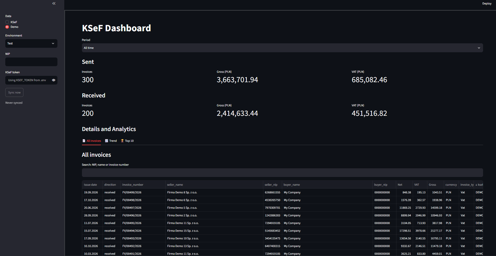

# KSeF Dashboard

**[Wersja polska poniżej ↓](#po-polsku)**

Local, read-only dashboard for your invoices in **KSeF 2.0** (Krajowy System e-Faktur).
See what you sent and received in any period: invoice counts, gross and VAT totals, trends, and top counterparties.



- **Runs on your computer only.** Invoices are cached in a local SQLite file; nothing is sent anywhere except the official KSeF API.
- **Read-only.** The app only calls KSeF read endpoints. Give it a token with only the **przeglądanie faktur** permission.
- **Test-mode** Can also be used with KSeF test environment. 
- **Try it without a token.** Demo mode ships 500 fake invoices to play around with.

## Quick start (1 minute)

Requires **Python 3.13+**.

```bash
git clone https://github.com/AlRbv/ksef_view_dashboard.git
cd ksef_view_dashboard
```

| Windows | Mac / Linux |
|---|---|
| double-click `run.bat` | `./run.sh` |

The first run installs dependencies (1–2 min). Your browser opens at `http://localhost:8501`.
In the sidebar, pick **Data → Demo**.

## Use your own KSeF data

1. **Get a token.** Log in to the KSeF app, generate a token with the **przeglądanie faktur** (view invoices) permission, and copy it.
2. **Create `.env`** (optional; you can also paste the token in the sidebar):
   ```bash
   cp .env.example .env
   ```
   | Variable | Example | Meaning |
   |---|---|---|
   | `KSEF_NIP` | `1234567890` | Your company's NIP |
   | `KSEF_TOKEN` | `...` | Token from step 1 |
3. **In the sidebar:** Data → **KSeF**, Environment → **Production** (or **Test** for a test token), then click **Sync now**.

The first sync downloads everything since 1 Feb 2026. Later syncs only fetch new invoices.

## What you get

- **Periods:** Last 7 days, This month, Last month, All time, Custom range
- **KPIs:** invoice count, gross PLN, VAT PLN, separately for sent and received
- **Trend chart:** daily, weekly, or monthly bars depending on the period length
- **All invoices:** table with search by NIP, company name, or invoice number
- **Top 10:** biggest buyers and sellers by gross PLN

## Good to know

- **Rate limits:** KSeF allows about 20 invoice queries per hour per NIP. The local cache means you only sync when you need fresh data; browsing the dashboard makes no API calls.
- **Currencies:** gross totals include only PLN invoices. VAT is always in PLN, so VAT totals include everything.
- **Corrections** (faktury korygujące) have negative amounts and reduce totals.
- **One database per environment:** `data/ksef_production.db`, `data/ksef_test.db`, `data/demo.db`. Delete a file to start fresh.
- **Security:** never commit `.env` (it's in `.gitignore`). Don't expose the app with tokens to your network: it has no login.

## Development

```bash
python -m venv .venv
.venv\Scripts\activate        # Mac/Linux: source .venv/bin/activate
pip install -r requirements.txt
python demo.py                # rebuild demo data
pytest -q
streamlit run app.py
```

## Po polsku

Lokalny dashboard tylko do odczytu dla Twoich faktur w **KSeF 2.0** (Krajowy System e-Faktur).
Sprawdź faktury wystawione i otrzymane w dowolnym okresie: liczbę faktur, sumy brutto i VAT, trendy oraz największych kontrahentów.

- **Działa tylko na Twoim komputerze.** Faktury są zapisywane w lokalnym pliku SQLite; żadne dane nie są wysyłane poza oficjalne API KSeF.
- **Tylko do odczytu.** Aplikacja wywołuje wyłącznie endpointy odczytu KSeF. Użyj tokena z samym uprawnieniem **przeglądanie faktur**.
- **Tryb testowy.** Działa także ze środowiskiem testowym KSeF.
- **Wypróbuj bez tokena.** Tryb Demo zawiera 500 fikcyjnych faktur do swobodnego testowania.

### Szybki start (1 minuta)

Wymaga **Pythona 3.13+**.

```bash
git clone https://github.com/AlRbv/ksef_view_dashboard.git
cd ksef_view_dashboard
```

| Windows | Mac / Linux |
|---|---|
| kliknij dwukrotnie `run.bat` | `./run.sh` |

Pierwsze uruchomienie instaluje zależności (1–2 min). Przeglądarka otworzy się pod adresem `http://localhost:8501`.
W panelu bocznym wybierz **Data → Demo**.

### Własne dane z KSeF

1. **Wygeneruj token.** Zaloguj się do aplikacji KSeF, wygeneruj token z uprawnieniem **przeglądanie faktur** i skopiuj go.
2. **Utwórz plik `.env`** (opcjonalnie; token możesz też wkleić w panelu bocznym):
   ```bash
   cp .env.example .env
   ```
   | Zmienna | Przykład | Znaczenie |
   |---|---|---|
   | `KSEF_NIP` | `1234567890` | NIP Twojej firmy |
   | `KSEF_TOKEN` | `...` | Token z kroku 1 |
3. **W panelu bocznym:** Data → **KSeF**, Environment → **Production** (lub **Test** dla tokena testowego), a następnie kliknij **Sync now**.

Pierwsza synchronizacja pobiera wszystkie faktury od 1 lutego 2026. Kolejne pobierają tylko nowe.

### Co otrzymujesz

- **Okresy:** Last 7 days, This month, Last month, All time, Custom range (nazwy jak w aplikacji)
- **Wskaźniki:** liczba faktur, brutto PLN, VAT PLN, osobno dla wystawionych i otrzymanych
- **Wykres trendu:** słupki dzienne, tygodniowe lub miesięczne, zależnie od długości okresu
- **Wszystkie faktury:** tabela z wyszukiwaniem po NIP, nazwie firmy lub numerze faktury
- **Top 10:** najwięksi nabywcy i sprzedawcy według kwoty brutto PLN

### Warto wiedzieć

- **Limity zapytań:** KSeF pozwala na ok. 20 zapytań o faktury na godzinę dla jednego NIP. Dzięki lokalnej bazie synchronizujesz tylko wtedy, gdy potrzebujesz świeżych danych; przeglądanie dashboardu nie wysyła żadnych zapytań do API.
- **Waluty:** sumy brutto obejmują tylko faktury w PLN. VAT jest zawsze w PLN, więc sumy VAT obejmują wszystkie faktury.
- **Korekty** (faktury korygujące) mają ujemne kwoty i pomniejszają sumy.
- **Osobna baza dla każdego środowiska:** `data/ksef_production.db`, `data/ksef_test.db`, `data/demo.db`. Usuń plik, aby zacząć od nowa.
- **Bezpieczeństwo:** nigdy nie commituj pliku `.env` (jest w `.gitignore`). Nie udostępniaj aplikacji z tokenami w sieci, ponieważ nie ma logowania.

### Dla programistów

```bash
python -m venv .venv
.venv\Scripts\activate        # Mac/Linux: source .venv/bin/activate
pip install -r requirements.txt
python demo.py                # odtworzenie danych demo
pytest -q
streamlit run app.py
```

## License

MIT